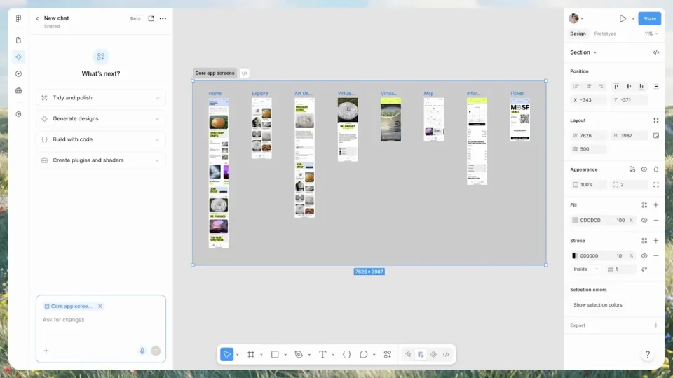

# Google Drive 接入 Figma agent

外部资料进入设计，设计变化再写回文档。用一次修改把资料连接、设计执行和变更说明串成闭环。

```motion-demo
{
  "id": "sequence",
  "title": "整体编排",
  "src": "demos/sequence.html",
  "duration": 44.377667,
  "status": "authored",
  "description": "动作与构图示意",
  "initialTime": 9,
  "params": [
    {
      "key": "title",
      "label": "示例主文案",
      "type": "text",
      "value": "Connect Google Drive",
      "maxLength": 60
    },
    {
      "key": "accent",
      "label": "强调色",
      "type": "color",
      "value": "#96d93c"
    }
  ],
  "presets": [
    {
      "label": "默认内容",
      "values": {
        "title": "Connect Google Drive",
        "accent": "#96d93c"
      }
    },
    {
      "label": "OpenDesign 改编",
      "values": {
        "title": "OpenDesign",
        "accent": "#7050da"
      }
    }
  ]
}
```

## 设计画布始终是同一个对象

先建立主设计帧，再通过侧栏输入带来源的需求。画布、输入和引用可以轮流放大，但设计标题与关键轮廓持续可辨，避免切换成另一份作品。



## 来源先于修改出现

请求之后展示检索与引用，让反馈内容进入视线，再改变相应组件。修改聚焦局部，其他设计区域保持稳定；结果细节要能对应刚刚展示的反馈。

```motion-demo
{
  "id": "clip-2",
  "title": "来源先于修改出现",
  "src": "demos/clip-2.html",
  "duration": 20,
  "status": "authored",
  "description": "4–24 秒 · 动作示意",
  "initialTime": 0.6
}
```

## 把设计结果转成说明文档

确认设计细节后请求总结，文档再记录改了什么与为什么。导出完成后落到连接主张与双品牌，不再增加另一个任务。

| 时间 | 段落 |
|---|---|
| 0.00–4.00s | 设计画布 |
| 4.00–9.00s | 输入带来源的需求 |
| 9.00–13.00s | 检索文件 |
| 13.00–18.00s | 引用证据 |
| 18.00–24.00s | 局部修改 |
| 24.00–28.00s | 结果细节 |
| 28.00–34.00s | 请求总结文档 |
| 34.00–39.00s | 导出文档 |
| 39.00–44.38s | 连接主张与双品牌 |

## 深色外层、明亮工作面

深灰背景承接浅色画布与对话区，绿、紫、橙用于选择、重点与示意素材。无衬线标题保持明确，引用文字和文档正文用常规字重；来源与对应组件在构图上尽量靠近。

## 换资料库时保留读写闭环

替换外部文件、反馈、设计组件和总结文档。引用必须能解释实际修改，导出文档也需记录同一次变化；连接工具图标随来源与目标一起更新。

## 配色与字形

无衬线中粗主标题；细边框界面与小号功能文字。

#161616 · #f6f6ef · #96d93c · #8d56d7 · #f56c3d

## 元素与制作规则

设计帧 / 对话侧栏 / 外部文件 / 引用 / 修改组件 / 总结文档

- 外部反馈被读取后产生设计修改，再输出记录变更原因的文档；形成读写闭环。
- 镜头在输入、引用与画布结果之间切换，保持同一设计帧身份。

## 内容替换

- 可迁移其他资料库与设计工具；保留来源→修改→记录。

## 制作参数

[视觉与对象](style.json) · [段落时序](timeline.json) · [位置数据](tracks.json) · [文件清单](manifest.json)

此规范根据参考视频整理。HTML 为可编辑的编排示例；具体数据的来源、精度与有效区间随文件标注。

```motion-board
{
  "version": 1,
  "brand": "Figma",
  "id": "V107",
  "palette": [
    "#161616",
    "#f6f6ef",
    "#96d93c",
    "#8d56d7",
    "#f56c3d"
  ],
  "typography": "无衬线中粗主标题；细边框界面与小号功能文字",
  "sample": "Connect Google Drive",
  "objects": [
    "设计帧",
    "对话侧栏",
    "外部文件",
    "引用",
    "修改组件",
    "总结文档"
  ],
  "frames": [
    {
      "path": "assets/reference-1.webp",
      "timeSeconds": 0.0,
      "frameId": "K0001",
      "role": "reference-evidence",
      "status": "measured"
    },
    {
      "path": "assets/reference-2.webp",
      "timeSeconds": 9.008999999999999,
      "frameId": "K0017",
      "role": "reference-evidence",
      "status": "measured"
    },
    {
      "path": "https://r.open-design.ai/files/4300c0586d0c05cea42dcd739db1909f94e31e2cdb9049febb455d931be11f98",
      "timeSeconds": 13.013,
      "frameId": "K0033",
      "role": "reference-evidence",
      "status": "measured"
    },
    {
      "path": "https://r.open-design.ai/files/2dd4aef1722bf90154f331e89a4d4c90c61615cdfa373dce374fd7b103af2a07",
      "timeSeconds": 24.023999999999997,
      "frameId": "K0065",
      "role": "reference-evidence",
      "status": "measured"
    },
    {
      "path": "assets/reference-5.webp",
      "timeSeconds": 28.028,
      "frameId": "K0073",
      "role": "reference-evidence",
      "status": "measured"
    },
    {
      "path": "assets/reference-6.webp",
      "timeSeconds": 39.038999999999994,
      "frameId": "K0101",
      "role": "reference-evidence",
      "status": "measured"
    }
  ],
  "stages": [
    {
      "start": 0,
      "label": "设计画布",
      "end": 4,
      "status": "inferred",
      "basis": "Representative-frame review; approximate boundaries"
    },
    {
      "start": 4,
      "label": "输入带来源的需求",
      "end": 9,
      "status": "inferred",
      "basis": "Representative-frame review; approximate boundaries"
    },
    {
      "start": 9,
      "label": "检索文件",
      "end": 13,
      "status": "inferred",
      "basis": "Representative-frame review; approximate boundaries"
    },
    {
      "start": 13,
      "label": "引用证据",
      "end": 18,
      "status": "inferred",
      "basis": "Representative-frame review; approximate boundaries"
    },
    {
      "start": 18,
      "label": "局部修改",
      "end": 24,
      "status": "inferred",
      "basis": "Representative-frame review; approximate boundaries"
    },
    {
      "start": 24,
      "label": "结果细节",
      "end": 28,
      "status": "inferred",
      "basis": "Representative-frame review; approximate boundaries"
    },
    {
      "start": 28,
      "label": "请求总结文档",
      "end": 34,
      "status": "inferred",
      "basis": "Representative-frame review; approximate boundaries"
    },
    {
      "start": 34,
      "label": "导出文档",
      "end": 39,
      "status": "inferred",
      "basis": "Representative-frame review; approximate boundaries"
    },
    {
      "start": 39,
      "label": "连接主张与双品牌",
      "end": 44.377667,
      "status": "inferred",
      "basis": "Representative-frame review; approximate boundaries"
    }
  ],
  "duration": 44.377667,
  "fontFamily": "Arial, sans-serif"
}
```
