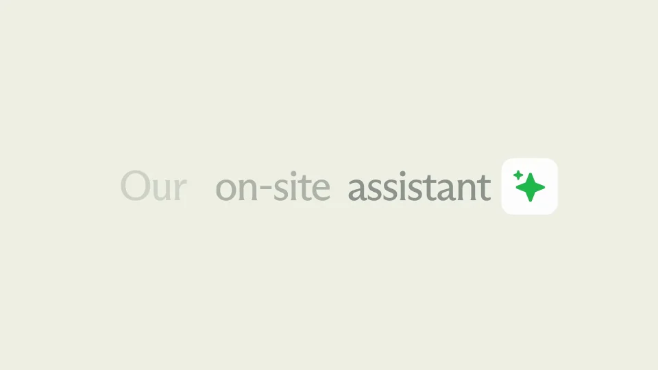

# Mintlify Widget — an embedded agent that supports your users anywhere

用一个轻量入口连接提问、回答和资料来源，让助手功能自然嵌入现有页面。

```motion-demo
{
  "id": "sequence",
  "title": "整体编排",
  "src": "demos/sequence.html",
  "duration": 22.68,
  "status": "authored",
  "description": "动作与构图示意",
  "initialTime": 11.5,
  "params": [
    {
      "key": "title",
      "label": "示例主文案",
      "type": "text",
      "value": "Ask assistant",
      "maxLength": 60
    },
    {
      "key": "accent",
      "label": "强调色",
      "type": "color",
      "value": "#28ad61"
    }
  ],
  "presets": [
    {
      "label": "默认内容",
      "values": {
        "title": "Ask assistant",
        "accent": "#28ad61"
      }
    },
    {
      "label": "OpenDesign 改编",
      "values": {
        "title": "OpenDesign",
        "accent": "#7050da"
      }
    }
  ]
}
```

## 先交代入口，再演示操作

米绿背景上保留小尺度助手标记，文字从标记两侧接续。代码卡只作安装能力的短说明，避免占据整段。

按钮和输入框沿用相同圆角，绿色只标记交互焦点。



## 一个按钮展开成对话面板

先拉开容器，再出现建议问题和输入框；提问提交后留出回答区。镜头靠近面板时保持阅读方向。

```motion-demo
{
  "id": "clip-2",
  "title": "一个按钮展开成对话面板",
  "src": "demos/clip-2.html",
  "duration": 3.7,
  "status": "authored",
  "description": "7.8–11.5 秒 · 动作示意",
  "initialTime": 0.6
}
```

## 答案之后给出可展开的来源

来源收在同一组列表里，光标依次移动时只高亮当前行。完成演示后收回入口，留下品牌。

```motion-demo
{
  "id": "clip-3",
  "title": "答案之后给出可展开的来源",
  "src": "demos/clip-3.html",
  "duration": 2.8000000000000007,
  "status": "authored",
  "description": "14–16.8 秒 · 动作示意",
  "initialTime": 0.6
}
```

## 替换场景内容

用户问题、回答与来源应互相对应。迁移到其他产品时，保留单入口和完整问答链。

| 时间 | 段落 |
|---|---|
| 0.00–1.00s | 助手标记 |
| 1.00–5.00s | 短句说明嵌入能力 |
| 5.00–8.00s | 代码片段 |
| 8.00–10.50s | 按钮展开对话 |
| 10.50–14.00s | 生成回答 |
| 14.00–18.00s | 展开来源 |
| 18.00–21.00s | 主张与按钮 |
| 21.00–22.68s | 品牌收尾 |

## 配色与字形

清晰无衬线文案；浅米绿背景、白色圆角面板与细绿输入框。

#eef0e6 · #20271e · #28ad61 · #ffffff · #c8d1bf

## 元素与制作规则

星形助手标记 / 嵌入代码卡 / 悬浮入口 / 对话面板 / 来源列表

- 先用一个小标记承接两句文案，再切入代码卡与真实使用过程。
- 按钮展开后保持输入框、回答和来源的层级；倾斜镜头只用于突出当前操作。
- 来源列表按行高亮，与光标移动同步；操作结束再回到简短主张。

## 内容替换

- 替换助手品牌、用户问题与资料来源；保留入口→提问→回答→查来源的因果链。
- 一次只展示一个短问题，回答控制在4–6行，资料来源保留三项左右。

## 制作参数

[视觉与对象](style.json) · [段落时序](timeline.json) · [位置数据](tracks.json) · [文件清单](manifest.json)

此规范根据参考视频整理。HTML 为可编辑的编排示例；具体数据的来源、精度与有效区间随文件标注。

```motion-board
{
  "version": 1,
  "brand": "Mintlify",
  "id": "V394",
  "palette": [
    "#eef0e6",
    "#20271e",
    "#28ad61",
    "#ffffff",
    "#c8d1bf"
  ],
  "typography": "清晰无衬线文案；浅米绿背景、白色圆角面板与细绿输入框",
  "sample": "Ask assistant",
  "objects": [
    "星形助手标记",
    "嵌入代码卡",
    "悬浮入口",
    "对话面板",
    "来源列表"
  ],
  "frames": [
    {
      "path": "assets/reference-1.webp",
      "timeSeconds": 0.0,
      "frameId": "K0001",
      "role": "reference-evidence",
      "status": "measured"
    },
    {
      "path": "assets/reference-2.webp",
      "timeSeconds": 1.0,
      "frameId": "K0005",
      "role": "reference-evidence",
      "status": "measured"
    },
    {
      "path": "assets/reference-3.webp",
      "timeSeconds": 8.0,
      "frameId": "K0016",
      "role": "reference-evidence",
      "status": "measured"
    },
    {
      "path": "assets/reference-4.webp",
      "timeSeconds": 10.56,
      "frameId": "K0024",
      "role": "reference-evidence",
      "status": "measured"
    },
    {
      "path": "assets/reference-5.webp",
      "timeSeconds": 18.0,
      "frameId": "K0044",
      "role": "reference-evidence",
      "status": "measured"
    },
    {
      "path": "assets/reference-6.webp",
      "timeSeconds": 21.0,
      "frameId": "K0049",
      "role": "reference-evidence",
      "status": "measured"
    }
  ],
  "stages": [
    {
      "start": 0,
      "label": "助手标记",
      "end": 1,
      "status": "inferred",
      "basis": "Representative-frame review; approximate boundaries"
    },
    {
      "start": 1,
      "label": "短句说明嵌入能力",
      "end": 5,
      "status": "inferred",
      "basis": "Representative-frame review; approximate boundaries"
    },
    {
      "start": 5,
      "label": "代码片段",
      "end": 8,
      "status": "inferred",
      "basis": "Representative-frame review; approximate boundaries"
    },
    {
      "start": 8,
      "label": "按钮展开对话",
      "end": 10.5,
      "status": "inferred",
      "basis": "Representative-frame review; approximate boundaries"
    },
    {
      "start": 10.5,
      "label": "生成回答",
      "end": 14,
      "status": "inferred",
      "basis": "Representative-frame review; approximate boundaries"
    },
    {
      "start": 14,
      "label": "展开来源",
      "end": 18,
      "status": "inferred",
      "basis": "Representative-frame review; approximate boundaries"
    },
    {
      "start": 18,
      "label": "主张与按钮",
      "end": 21,
      "status": "inferred",
      "basis": "Representative-frame review; approximate boundaries"
    },
    {
      "start": 21,
      "label": "品牌收尾",
      "end": 22.68,
      "status": "inferred",
      "basis": "Representative-frame review; approximate boundaries"
    }
  ],
  "duration": 22.68,
  "fontFamily": "Arial, sans-serif"
}
```
