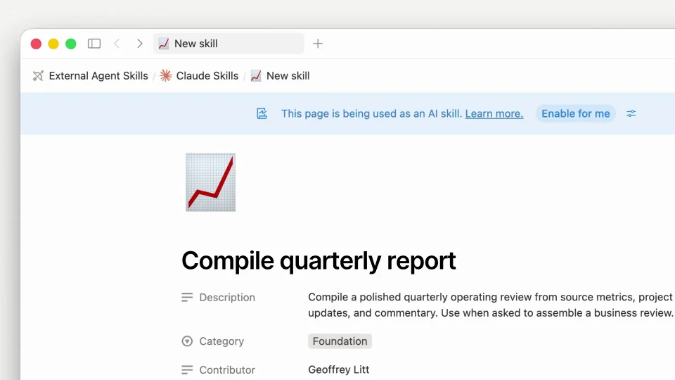

# Notion Skills API — skills for ChatGPT and Claude

用三段对应关系演示共享知识如何流转：一起编辑，进入仓库，再被不同代理使用。

```motion-demo
{
  "id": "sequence",
  "title": "整体编排",
  "src": "demos/sequence.html",
  "duration": 23.766788,
  "status": "authored",
  "description": "动作与构图示意",
  "initialTime": 6,
  "params": [
    {
      "key": "title",
      "label": "示例主文案",
      "type": "text",
      "value": "Edit skills together",
      "maxLength": 60
    },
    {
      "key": "accent",
      "label": "强调色",
      "type": "color",
      "value": "#2f91cb"
    }
  ],
  "presets": [
    {
      "label": "默认内容",
      "values": {
        "title": "Edit skills together",
        "accent": "#2f91cb"
      }
    },
    {
      "label": "OpenDesign 改编",
      "values": {
        "title": "OpenDesign",
        "accent": "#7050da"
      }
    }
  ]
}
```

## 每句主张后跟一个具体界面

协作编辑主张接技能文档，自动同步主张接仓库目录，跨代理主张接消费界面。短标题先出现，界面紧随其后；三段使用相近的停留长度，形成清楚的节拍。

| 时间 | 段落 |
|---|---|
| 0.00–2.00s | 协作编辑主张 |
| 2.00–6.00s | 技能页 |
| 6.00–8.00s | 同步主张 |
| 8.00–12.00s | 仓库目录 |
| 12.00–14.00s | 跨代理主张 |
| 14.00–18.00s | 代理消费 |
| 18.00–21.00s | 总结 |
| 21.00–23.77s | 品牌 |

## 一个文档跨三个容器

技能名称和文件身份在编辑页、仓库和代理窗口中持续可见。转场改变容器而保留关键词，观众不用通过漂浮箭头也能判断这是同一份内容。



## 让内容比应用装饰更突出

白底、细边框和无衬线中粗标题建立轻量工具风格。浅蓝、杏色、紫色只用于段落区分和关键选择；正文行距留足，仓库层级和代理输入区各突出一个焦点。

## 可替换成规范或设计系统

选一份能跨工具共享的内容，统一编辑名称、仓库文件和代理调用文本。保留“写入→分发→使用”，并让每个界面展示自己的具体职责。

## 配色与字形

无衬线中粗主标题；细边框界面与小号功能文字。

#ffffff · #191919 · #2f91cb · #f2e1bb · #aea0ce

## 元素与制作规则

技能文档 / 仓库目录 / 多个代理窗口 / 主张字幕

- 同一技能从文档编辑到仓库同步再到多个代理消费，信息跨容器保持身份。
- 短主张先行、对应界面跟进形成三段结构。

## 内容替换

- 可换规范、设计系统或其他共享知识，保留写入→分发→消费。

## 制作参数

[视觉与对象](style.json) · [段落时序](timeline.json) · [位置数据](tracks.json) · [文件清单](manifest.json)

此规范根据参考视频整理。HTML 为可编辑的编排示例；具体数据的来源、精度与有效区间随文件标注。

```motion-board
{
  "version": 1,
  "brand": "Notion",
  "id": "V088",
  "palette": [
    "#ffffff",
    "#191919",
    "#2f91cb",
    "#f2e1bb",
    "#aea0ce"
  ],
  "typography": "无衬线中粗主标题；细边框界面与小号功能文字",
  "sample": "Edit skills together",
  "objects": [
    "技能文档",
    "仓库目录",
    "多个代理窗口",
    "主张字幕"
  ],
  "frames": [
    {
      "path": "assets/reference-1.webp",
      "timeSeconds": 0.0,
      "frameId": "K0001",
      "role": "reference-evidence",
      "status": "measured"
    },
    {
      "path": "assets/reference-2.webp",
      "timeSeconds": 2.000010226741468,
      "frameId": "K0005",
      "role": "reference-evidence",
      "status": "measured"
    },
    {
      "path": "assets/reference-3.webp",
      "timeSeconds": 8.000040906965872,
      "frameId": "K0019",
      "role": "reference-evidence",
      "status": "measured"
    },
    {
      "path": "assets/reference-4.webp",
      "timeSeconds": 12.000061360448807,
      "frameId": "K0029",
      "role": "reference-evidence",
      "status": "measured"
    },
    {
      "path": "assets/reference-5.webp",
      "timeSeconds": 18.000092040673213,
      "frameId": "K0045",
      "role": "reference-evidence",
      "status": "measured"
    },
    {
      "path": "assets/reference-6.webp",
      "timeSeconds": 21.000107380785416,
      "frameId": "K0051",
      "role": "reference-evidence",
      "status": "measured"
    }
  ],
  "stages": [
    {
      "start": 0,
      "label": "协作编辑主张",
      "end": 2,
      "status": "inferred",
      "basis": "Representative-frame review; approximate boundaries"
    },
    {
      "start": 2,
      "label": "技能页",
      "end": 6,
      "status": "inferred",
      "basis": "Representative-frame review; approximate boundaries"
    },
    {
      "start": 6,
      "label": "同步主张",
      "end": 8,
      "status": "inferred",
      "basis": "Representative-frame review; approximate boundaries"
    },
    {
      "start": 8,
      "label": "仓库目录",
      "end": 12,
      "status": "inferred",
      "basis": "Representative-frame review; approximate boundaries"
    },
    {
      "start": 12,
      "label": "跨代理主张",
      "end": 14,
      "status": "inferred",
      "basis": "Representative-frame review; approximate boundaries"
    },
    {
      "start": 14,
      "label": "代理消费",
      "end": 18,
      "status": "inferred",
      "basis": "Representative-frame review; approximate boundaries"
    },
    {
      "start": 18,
      "label": "总结",
      "end": 21,
      "status": "inferred",
      "basis": "Representative-frame review; approximate boundaries"
    },
    {
      "start": 21,
      "label": "品牌",
      "end": 23.766788,
      "status": "inferred",
      "basis": "Representative-frame review; approximate boundaries"
    }
  ],
  "duration": 23.766788,
  "fontFamily": "Arial, sans-serif"
}
```
