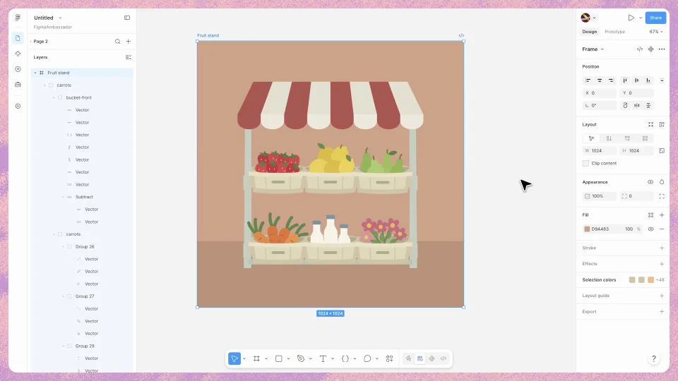

# Figma Agent Vectors

连续证明素材的三种能力：可以生成，可以手工编辑，也可以成为动画对象。每一段都沿用同一组场景素材。

```motion-demo
{
  "id": "sequence",
  "title": "整体编排",
  "src": "demos/sequence.html",
  "duration": 39.875,
  "status": "authored",
  "description": "动作与构图示意",
  "initialTime": 10,
  "params": [
    {
      "key": "title",
      "label": "示例主文案",
      "type": "text",
      "value": "Generate, edit, animate",
      "maxLength": 60
    },
    {
      "key": "accent",
      "label": "强调色",
      "type": "color",
      "value": "#a65e4f"
    }
  ],
  "presets": [
    {
      "label": "默认内容",
      "values": {
        "title": "Generate, edit, animate",
        "accent": "#a65e4f"
      }
    },
    {
      "label": "OpenDesign 改编",
      "values": {
        "title": "OpenDesign",
        "accent": "#7050da"
      }
    }
  ]
}
```

## 在既有插画里补一个对象

先建立市场场景，再用请求新增蔬果。新素材进入后成为可选子对象，位置与比例服从原有场景，父容器保持稳定。



## 手工编辑让可编辑性变得可见

把新对象拖到合适位置，再从图层树选中并改色。轮廓、选中框和颜色面板保持对应；修改子对象时其余场景不跟着整体移动。

```motion-demo
{
  "id": "clip-2",
  "title": "手工编辑让可编辑性变得可见",
  "src": "demos/clip-2.html",
  "duration": 17,
  "status": "authored",
  "description": "10–27 秒 · 动作示意",
  "initialTime": 0.6
}
```

## 同一个对象继续进入时间线

动画请求之后出现轨道与回放，刚才编辑的素材继续承担主动作。运动范围留在场景内，避免为了展示动画而脱离原先构图。

| 时间 | 段落 |
|---|---|
| 0.00–4.00s | 市场插画 |
| 4.00–10.00s | 生成请求 |
| 10.00–14.00s | 新增素材 |
| 14.00–18.00s | 手工摆放 |
| 18.00–22.00s | 图层选择 |
| 22.00–27.00s | 颜色调整 |
| 27.00–31.00s | 动画请求 |
| 31.00–35.00s | 时间线回放 |
| 35.00–38.00s | 总结 |
| 38.00–39.88s | 品牌 |

## 暖色插画配轻量编辑界面

使用陶土、浅米和草绿形成自然素材感，深灰文字提供阅读对比。标题和工具文字用无衬线，作品可以有手工形状；父场景与独立物件通过大小、遮挡和间距形成层次。

## 换场景时选择可独立编辑的物件

可以换成桌面、花园或展台。准备清楚的父场景和子对象，让新增、改色和动画都作用于同一物件；请求文本与实际操作一起替换。

## 配色与字形

无衬线中粗主标题；细边框界面与小号功能文字。

#cda992 · #31302c · #a65e4f · #7e9d69 · #ece3cb

## 元素与制作规则

插画父容器 / 独立蔬果 / 图层树 / 颜色面板 / 动画时间线

- 新生成素材仍可选中、编辑颜色和编排动画；三阶段证明可编辑性。
- 蔬果作为子对象，容器不随每次编辑整体移动。

## 内容替换

- 可换场景与物件；保留生成→手工编辑→动画化。

## 制作参数

[视觉与对象](style.json) · [段落时序](timeline.json) · [位置数据](tracks.json) · [文件清单](manifest.json)

此规范根据参考视频整理。HTML 为可编辑的编排示例；具体数据的来源、精度与有效区间随文件标注。

```motion-board
{
  "version": 1,
  "brand": "Figma",
  "id": "V282",
  "palette": [
    "#cda992",
    "#31302c",
    "#a65e4f",
    "#7e9d69",
    "#ece3cb"
  ],
  "typography": "无衬线中粗主标题；细边框界面与小号功能文字",
  "sample": "Generate, edit, animate",
  "objects": [
    "插画父容器",
    "独立蔬果",
    "图层树",
    "颜色面板",
    "动画时间线"
  ],
  "frames": [
    {
      "path": "assets/reference-1.webp",
      "timeSeconds": 0.0,
      "frameId": "K0001",
      "role": "reference-evidence",
      "status": "measured"
    },
    {
      "path": "assets/reference-2.webp",
      "timeSeconds": 10.0,
      "frameId": "K0028",
      "role": "reference-evidence",
      "status": "measured"
    },
    {
      "path": "assets/reference-3.webp",
      "timeSeconds": 18.0,
      "frameId": "K0046",
      "role": "reference-evidence",
      "status": "measured"
    },
    {
      "path": "assets/reference-4.webp",
      "timeSeconds": 22.0,
      "frameId": "K0056",
      "role": "reference-evidence",
      "status": "measured"
    },
    {
      "path": "assets/reference-5.webp",
      "timeSeconds": 31.0,
      "frameId": "K0075",
      "role": "reference-evidence",
      "status": "measured"
    },
    {
      "path": "assets/reference-6.webp",
      "timeSeconds": 38.0,
      "frameId": "K0091",
      "role": "reference-evidence",
      "status": "measured"
    }
  ],
  "stages": [
    {
      "start": 0,
      "label": "市场插画",
      "end": 4,
      "status": "inferred",
      "basis": "Representative-frame review; approximate boundaries"
    },
    {
      "start": 4,
      "label": "生成请求",
      "end": 10,
      "status": "inferred",
      "basis": "Representative-frame review; approximate boundaries"
    },
    {
      "start": 10,
      "label": "新增素材",
      "end": 14,
      "status": "inferred",
      "basis": "Representative-frame review; approximate boundaries"
    },
    {
      "start": 14,
      "label": "手工摆放",
      "end": 18,
      "status": "inferred",
      "basis": "Representative-frame review; approximate boundaries"
    },
    {
      "start": 18,
      "label": "图层选择",
      "end": 22,
      "status": "inferred",
      "basis": "Representative-frame review; approximate boundaries"
    },
    {
      "start": 22,
      "label": "颜色调整",
      "end": 27,
      "status": "inferred",
      "basis": "Representative-frame review; approximate boundaries"
    },
    {
      "start": 27,
      "label": "动画请求",
      "end": 31,
      "status": "inferred",
      "basis": "Representative-frame review; approximate boundaries"
    },
    {
      "start": 31,
      "label": "时间线回放",
      "end": 35,
      "status": "inferred",
      "basis": "Representative-frame review; approximate boundaries"
    },
    {
      "start": 35,
      "label": "总结",
      "end": 38,
      "status": "inferred",
      "basis": "Representative-frame review; approximate boundaries"
    },
    {
      "start": 38,
      "label": "品牌",
      "end": 39.875,
      "status": "inferred",
      "basis": "Representative-frame review; approximate boundaries"
    }
  ],
  "duration": 39.875,
  "fontFamily": "Arial, sans-serif"
}
```
