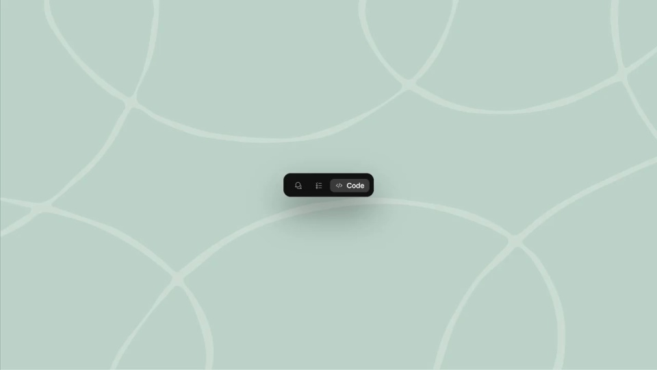

# Claude Code｜桌面多会话

用工作区的展开说明多任务能力：先完成一个请求，再展示预览、修改和并行会话。

```motion-demo
{
  "id": "sequence",
  "title": "整体编排",
  "src": "demos/sequence.html",
  "duration": 37.116667,
  "status": "authored",
  "description": "动作与构图示意",
  "initialTime": 8.6,
  "params": [
    {
      "key": "title",
      "label": "示例主文案",
      "type": "text",
      "value": "Claude Code",
      "maxLength": 60
    },
    {
      "key": "accent",
      "label": "强调色",
      "type": "color",
      "value": "#cd8066"
    }
  ],
  "presets": [
    {
      "label": "默认内容",
      "values": {
        "title": "Claude Code",
        "accent": "#cd8066"
      }
    },
    {
      "label": "OpenDesign 改编",
      "values": {
        "title": "OpenDesign",
        "accent": "#7050da"
      }
    }
  ]
}
```

## 先建立一个清晰的工作区

薄荷色留白包围深色主窗口。侧栏固定在左，当前任务占据中间；代码用等宽字，收尾产品名可切换为衬线字。

窗口展开时保持中心位置，等界面稳定后再输入请求。



## 让结果和修改留在同一窗口

预览从右侧展开，代码仍留在左侧。切换到差异和终端时沿用同一外框，避免观众重新寻找任务。

预览展示产物，差异展示改动，终端展示执行状态；三种信息使用不同的内部排版。

```motion-demo
{
  "id": "clip-2",
  "title": "让结果和修改留在同一窗口",
  "src": "demos/clip-2.html",
  "duration": 13,
  "status": "authored",
  "description": "10–23 秒 · 动作示意",
  "initialTime": 0.6
}
```

## 拉远后再展示多会话

把完整工作窗口缩为多个并排实例，让并行能力成为最后一次信息扩展。每个会话拥有独立内容，但共享窗口样式。

## 改成其他工具时

可换品牌、任务和预览内容。保留请求、产物与修改之间的对应；设计工具可用画板预览和局部改稿替代代码差异。

## 配色与字形

薄荷底、黑色工作区、等宽代码、衬线收尾。

#b8cec6 · #131413 · #cd8066 · #8973b8 · #e7e5db

## 元素与制作规则

主工作区 / 侧边会话栏 / 预览面板 / 代码差异 / 终端 / 指针

- 主窗口先展开，随后从单列长成预览与代码并列；面板是同一工作区子层。
- 切换 Preview、Diff、Terminal 展示不同信息，窗口位置保持连续。
- 最后拉远显示多会话，再切黑色落版。

## 内容替换

- 迁移成设计工具时保留请求→结果预览→修改证据的关系。
- 可换代码和预览内容，不能把内部变化全变成窗口平移。

## 制作参数

[视觉与对象](style.json) · [段落时序](timeline.json) · [位置数据](tracks.json) · [文件清单](manifest.json)

此规范根据参考视频整理。HTML 为可编辑的编排示例；具体数据的来源、精度与有效区间随文件标注。

```motion-board
{
  "version": 1,
  "brand": "Anthropic",
  "id": "V242",
  "palette": [
    "#b8cec6",
    "#131413",
    "#cd8066",
    "#8973b8",
    "#e7e5db"
  ],
  "typography": "薄荷底、黑色工作区、等宽代码、衬线收尾",
  "sample": "Claude Code",
  "objects": [
    "主工作区",
    "侧边会话栏",
    "预览面板",
    "代码差异",
    "终端",
    "指针"
  ],
  "frames": [
    {
      "path": "assets/reference-1.jpg",
      "timeSeconds": 0.0,
      "frameId": "K0001",
      "role": "reference-evidence",
      "status": "measured"
    },
    {
      "path": "assets/reference-2.jpg",
      "timeSeconds": 1.0,
      "frameId": "K0005",
      "role": "reference-evidence",
      "status": "measured"
    },
    {
      "path": "assets/reference-3.jpg",
      "timeSeconds": 5.0,
      "frameId": "K0013",
      "role": "reference-evidence",
      "status": "measured"
    },
    {
      "path": "assets/reference-4.jpg",
      "timeSeconds": 14.0,
      "frameId": "K0041",
      "role": "reference-evidence",
      "status": "measured"
    },
    {
      "path": "assets/reference-5.jpg",
      "timeSeconds": 23.0,
      "frameId": "K0065",
      "role": "reference-evidence",
      "status": "measured"
    },
    {
      "path": "assets/reference-6.jpg",
      "timeSeconds": 30.0,
      "frameId": "K0090",
      "role": "reference-evidence",
      "status": "measured"
    }
  ],
  "stages": [
    {
      "start": 0,
      "label": "入口收拢",
      "end": 1,
      "status": "inferred",
      "basis": "Representative-frame review; approximate boundaries"
    },
    {
      "start": 1,
      "label": "主窗口展开",
      "end": 5,
      "status": "inferred",
      "basis": "Representative-frame review; approximate boundaries"
    },
    {
      "start": 5,
      "label": "请求与代码",
      "end": 10,
      "status": "inferred",
      "basis": "Representative-frame review; approximate boundaries"
    },
    {
      "start": 10,
      "label": "预览并排",
      "end": 14,
      "status": "inferred",
      "basis": "Representative-frame review; approximate boundaries"
    },
    {
      "start": 14,
      "label": "差异与终端",
      "end": 23,
      "status": "inferred",
      "basis": "Representative-frame review; approximate boundaries"
    },
    {
      "start": 23,
      "label": "多会话并列",
      "end": 30,
      "status": "inferred",
      "basis": "Representative-frame review; approximate boundaries"
    },
    {
      "start": 30,
      "label": "品牌收尾",
      "end": 37.116667,
      "status": "inferred",
      "basis": "Representative-frame review; approximate boundaries"
    }
  ],
  "duration": 37.116667,
  "fontFamily": "ui-monospace, monospace"
}
```
