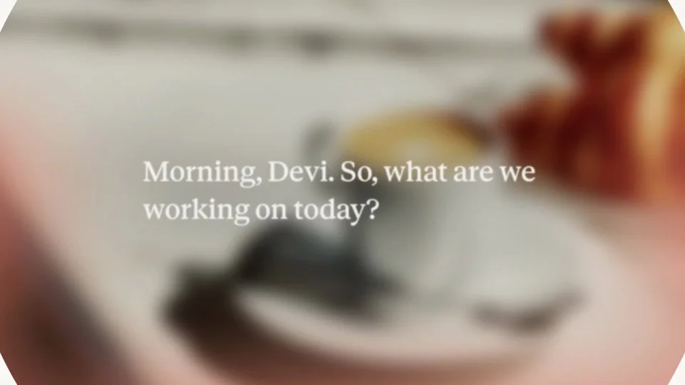

# 功能更新｜Voice mode

用同一个圆心串起按钮、画面和收尾。场景展开后降低背景细节，让一句逐词出现的对话成为视觉中心。

```motion-demo
{
  "id": "sequence",
  "title": "整体编排",
  "src": "demos/sequence.html",
  "duration": 11.458333,
  "status": "authored",
  "description": "动作与构图示意",
  "initialTime": 3,
  "params": [
    {
      "key": "title",
      "label": "示例主文案",
      "type": "text",
      "value": "Think out loud with Claude",
      "maxLength": 60
    },
    {
      "key": "accent",
      "label": "强调色",
      "type": "color",
      "value": "#d58a76"
    }
  ],
  "presets": [
    {
      "label": "默认内容",
      "values": {
        "title": "Think out loud with Claude",
        "accent": "#d58a76"
      }
    },
    {
      "label": "OpenDesign 改编",
      "values": {
        "title": "OpenDesign",
        "accent": "#7050da"
      }
    }
  ]
}
```

## 圆形是共同的入口

暖白留白、黑色语音圆钮、生活照片与白色衬线字幕。

同一中心圆从按钮扩张为影像窗口，再收回按钮；保持空间身份连续。

```motion-demo
{
  "id": "clip-1",
  "title": "圆形是共同的入口",
  "src": "demos/clip-1.html",
  "duration": 1.2,
  "status": "authored",
  "description": "0–1.2 秒 · 动作示意",
  "initialTime": 0.6
}
```

## 先展开场景，再开始说话

影像进入后虚化并叠暖色光晕，字幕随后出现；背景降低细节以支持阅读。

字幕是词组增量显示，退场后留口号，最后回到初始按钮。

| 时间 | 段落 |
|---|---|
| 0.00–0.50s | 语音圆钮 |
| 0.50–1.20s | 圆形遮罩展开 |
| 1.20–2.20s | 生活画面填满 |
| 2.20–6.00s | 字幕逐词出现 |
| 6.00–6.60s | 遮罩收回 |
| 6.60–9.50s | 口号留读 |
| 9.50–11.46s | 恢复圆钮 |

## 一句对话的容量

替换生活场景和一句对话；保留按钮→情境→话语→按钮的闭环。

字幕建议两行内，按词而非随机字符揭示；音频同步需要另行对齐。



## 配色与字形

暖白留白、黑色语音圆钮、生活照片与白色衬线字幕。

#f8f8f2 · #141511 · #d58a76 · #8c8d76 · #ffffff

## 元素与制作规则

语音圆钮 / 同心圆遮罩 / 背景影像 / 逐词字幕 / 口号

- 同一中心圆从按钮扩张为影像窗口，再收回按钮；保持空间身份连续。
- 影像进入后虚化并叠暖色光晕，字幕随后出现；背景降低细节以支持阅读。
- 字幕是词组增量显示，退场后留口号，最后回到初始按钮。

## 内容替换

- 替换生活场景和一句对话；保留按钮→情境→话语→按钮的闭环。
- 字幕建议两行内，按词而非随机字符揭示；音频同步需要另行对齐。

## 制作参数

[视觉与对象](style.json) · [段落时序](timeline.json) · [位置数据](tracks.json) · [文件清单](manifest.json)

此规范根据参考视频整理。HTML 为可编辑的编排示例；具体数据的来源、精度与有效区间随文件标注。

```motion-board
{
  "version": 1,
  "brand": "Anthropic",
  "id": "V008",
  "palette": [
    "#f8f8f2",
    "#141511",
    "#d58a76",
    "#8c8d76",
    "#ffffff"
  ],
  "typography": "暖白留白、黑色语音圆钮、生活照片与白色衬线字幕",
  "sample": "Think out loud with Claude",
  "objects": [
    "语音圆钮",
    "同心圆遮罩",
    "背景影像",
    "逐词字幕",
    "口号"
  ],
  "frames": [
    {
      "path": "assets/reference-1.webp",
      "timeSeconds": 0.0,
      "frameId": "K0001",
      "role": "reference-evidence",
      "status": "measured"
    },
    {
      "path": "assets/reference-2.webp",
      "timeSeconds": 0.5833333333333334,
      "frameId": "K0002",
      "role": "reference-evidence",
      "status": "measured"
    },
    {
      "path": "assets/reference-3.webp",
      "timeSeconds": 1.25,
      "frameId": "K0005",
      "role": "reference-evidence",
      "status": "measured"
    },
    {
      "path": "assets/reference-4.webp",
      "timeSeconds": 6.0,
      "frameId": "K0014",
      "role": "reference-evidence",
      "status": "measured"
    },
    {
      "path": "assets/reference-5.webp",
      "timeSeconds": 6.5,
      "frameId": "K0018",
      "role": "reference-evidence",
      "status": "measured"
    },
    {
      "path": "assets/reference-6.webp",
      "timeSeconds": 9.916666666666666,
      "frameId": "K0022",
      "role": "reference-evidence",
      "status": "measured"
    }
  ],
  "stages": [
    {
      "start": 0,
      "label": "语音圆钮",
      "end": 0.5,
      "status": "inferred",
      "basis": "Representative-frame review; approximate boundaries"
    },
    {
      "start": 0.5,
      "label": "圆形遮罩展开",
      "end": 1.2,
      "status": "inferred",
      "basis": "Representative-frame review; approximate boundaries"
    },
    {
      "start": 1.2,
      "label": "生活画面填满",
      "end": 2.2,
      "status": "inferred",
      "basis": "Representative-frame review; approximate boundaries"
    },
    {
      "start": 2.2,
      "label": "字幕逐词出现",
      "end": 6,
      "status": "inferred",
      "basis": "Representative-frame review; approximate boundaries"
    },
    {
      "start": 6,
      "label": "遮罩收回",
      "end": 6.6,
      "status": "inferred",
      "basis": "Representative-frame review; approximate boundaries"
    },
    {
      "start": 6.6,
      "label": "口号留读",
      "end": 9.5,
      "status": "inferred",
      "basis": "Representative-frame review; approximate boundaries"
    },
    {
      "start": 9.5,
      "label": "恢复圆钮",
      "end": 11.458333,
      "status": "inferred",
      "basis": "Representative-frame review; approximate boundaries"
    }
  ],
  "duration": 11.458333,
  "fontFamily": "Georgia, serif"
}
```
