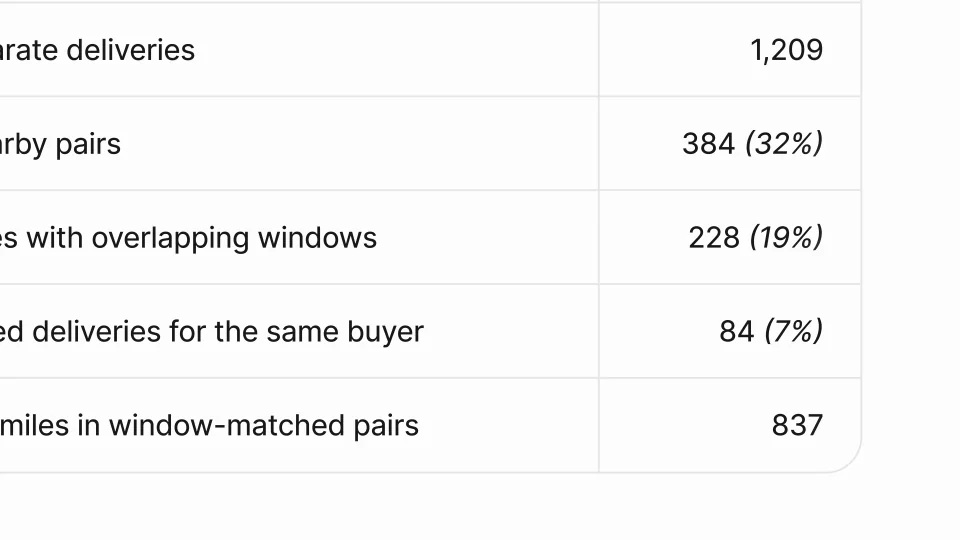

# Figma Specs

把需求、设计、规则与讨论整理成可交接的实现规格。内容从散布材料逐渐变得有结构，最后交给代理使用。

```motion-demo
{
  "id": "sequence",
  "title": "整体编排",
  "src": "demos/sequence.html",
  "duration": 40.75,
  "status": "authored",
  "description": "动作与构图示意",
  "initialTime": 8,
  "params": [
    {
      "key": "title",
      "label": "示例主文案",
      "type": "text",
      "value": "Specs",
      "maxLength": 60
    },
    {
      "key": "accent",
      "label": "强调色",
      "type": "color",
      "value": "#96d93c"
    }
  ],
  "presets": [
    {
      "label": "默认内容",
      "values": {
        "title": "Specs",
        "accent": "#96d93c"
      }
    },
    {
      "label": "OpenDesign 改编",
      "values": {
        "title": "OpenDesign",
        "accent": "#7050da"
      }
    }
  ]
}
```

## 用不同内容形态建立材料层次

先展示需求文档，再引入数据、规则表、代码块和评论。每种材料保留自己的排版：表格便于比较，代码便于定位，评论附着在被讨论的位置。



## 协作修订改变组织方式

评论之后进行内容重排，再把设计帧与说明并置。重排时保留主要标题，使观众知道内容仍然是同一份需求；设计与相应说明靠近，减少跨画面寻找。

```motion-demo
{
  "id": "clip-2",
  "title": "协作修订改变组织方式",
  "src": "demos/clip-2.html",
  "duration": 13,
  "status": "authored",
  "description": "15–28 秒 · 动作示意",
  "initialTime": 0.6
}
```

## 整理完成后才生成交接规格

规格产物出现在文档和设计关系清楚之后，最后进入代理消费。前半允许较高信息密度，交接时收束到标题、关键约束和明确入口。

| 时间 | 段落 |
|---|---|
| 0.00–4.00s | 需求文档 |
| 4.00–8.00s | 引用数据 |
| 8.00–11.00s | 规则表 |
| 11.00–15.00s | 代码框 |
| 15.00–18.00s | 协作评论 |
| 18.00–22.00s | 重排内容 |
| 22.00–28.00s | 文档与设计并置 |
| 28.00–32.00s | 生成实现规格 |
| 32.00–36.00s | 规格产物 |
| 36.00–39.00s | 代理消费 |
| 39.00–40.75s | 品牌 |

## 文档的阅读层级就是视觉风格

浅色文档面板置于深灰外层，绿紫橙只做局部选择与创作强调。标题和正文用无衬线分清字重，代码使用等宽字；表格、设计帧和评论各有边界，不挤在同一信息层。

## 换需求时重组材料而非只改标题

替换业务目标、规则、设计和代码示例，再让评论推动一次有意义的修订。最终规格应能说明前面材料形成的决策，代理入口继续使用同一任务名称。

## 配色与字形

无衬线中粗主标题；细边框界面与小号功能文字。

#161616 · #f6f6ef · #96d93c · #8d56d7 · #f56c3d

## 元素与制作规则

需求文档 / 规则表 / 代码块 / 评论 / 设计帧 / 实现规格

- 文档聚合业务、设计和代码证据，评论驱动重排，最后转为可执行交接规格。
- 设计帧与说明并排显示归属，不丢失来源上下文。

## 内容替换

- 可换需求类型；保留证据汇总→协作修订→实现交接。

## 制作参数

[视觉与对象](style.json) · [段落时序](timeline.json) · [位置数据](tracks.json) · [文件清单](manifest.json)

此规范根据参考视频整理。HTML 为可编辑的编排示例；具体数据的来源、精度与有效区间随文件标注。

```motion-board
{
  "version": 1,
  "brand": "Figma",
  "id": "V277",
  "palette": [
    "#161616",
    "#f6f6ef",
    "#96d93c",
    "#8d56d7",
    "#f56c3d"
  ],
  "typography": "无衬线中粗主标题；细边框界面与小号功能文字",
  "sample": "Specs",
  "objects": [
    "需求文档",
    "规则表",
    "代码块",
    "评论",
    "设计帧",
    "实现规格"
  ],
  "frames": [
    {
      "path": "assets/reference-1.webp",
      "timeSeconds": 0.0,
      "frameId": "K0001",
      "role": "reference-evidence",
      "status": "measured"
    },
    {
      "path": "assets/reference-2.webp",
      "timeSeconds": 8.0,
      "frameId": "K0026",
      "role": "reference-evidence",
      "status": "measured"
    },
    {
      "path": "https://r.open-design.ai/files/ec790d9cf3bcbd31e0fce7012f4f922af7cb8d4ea78b6b82244a7b1f58c01592",
      "timeSeconds": 15.0,
      "frameId": "K0049",
      "role": "reference-evidence",
      "status": "measured"
    },
    {
      "path": "https://r.open-design.ai/files/4173b2b2e4790fba166f9ace9ad1e4e97024a9837199ebf4d2603e338e20adbc",
      "timeSeconds": 22.0,
      "frameId": "K0075",
      "role": "reference-evidence",
      "status": "measured"
    },
    {
      "path": "assets/reference-5.webp",
      "timeSeconds": 32.0,
      "frameId": "K0114",
      "role": "reference-evidence",
      "status": "measured"
    },
    {
      "path": "assets/reference-6.webp",
      "timeSeconds": 39.0,
      "frameId": "K0141",
      "role": "reference-evidence",
      "status": "measured"
    }
  ],
  "stages": [
    {
      "start": 0,
      "label": "需求文档",
      "end": 4,
      "status": "inferred",
      "basis": "Representative-frame review; approximate boundaries"
    },
    {
      "start": 4,
      "label": "引用数据",
      "end": 8,
      "status": "inferred",
      "basis": "Representative-frame review; approximate boundaries"
    },
    {
      "start": 8,
      "label": "规则表",
      "end": 11,
      "status": "inferred",
      "basis": "Representative-frame review; approximate boundaries"
    },
    {
      "start": 11,
      "label": "代码框",
      "end": 15,
      "status": "inferred",
      "basis": "Representative-frame review; approximate boundaries"
    },
    {
      "start": 15,
      "label": "协作评论",
      "end": 18,
      "status": "inferred",
      "basis": "Representative-frame review; approximate boundaries"
    },
    {
      "start": 18,
      "label": "重排内容",
      "end": 22,
      "status": "inferred",
      "basis": "Representative-frame review; approximate boundaries"
    },
    {
      "start": 22,
      "label": "文档与设计并置",
      "end": 28,
      "status": "inferred",
      "basis": "Representative-frame review; approximate boundaries"
    },
    {
      "start": 28,
      "label": "生成实现规格",
      "end": 32,
      "status": "inferred",
      "basis": "Representative-frame review; approximate boundaries"
    },
    {
      "start": 32,
      "label": "规格产物",
      "end": 36,
      "status": "inferred",
      "basis": "Representative-frame review; approximate boundaries"
    },
    {
      "start": 36,
      "label": "代理消费",
      "end": 39,
      "status": "inferred",
      "basis": "Representative-frame review; approximate boundaries"
    },
    {
      "start": 39,
      "label": "品牌",
      "end": 40.75,
      "status": "inferred",
      "basis": "Representative-frame review; approximate boundaries"
    }
  ],
  "duration": 40.75,
  "fontFamily": "Arial, sans-serif"
}
```
